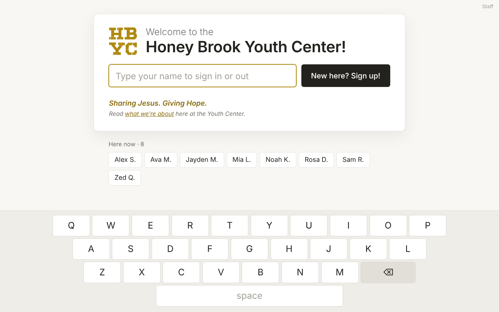
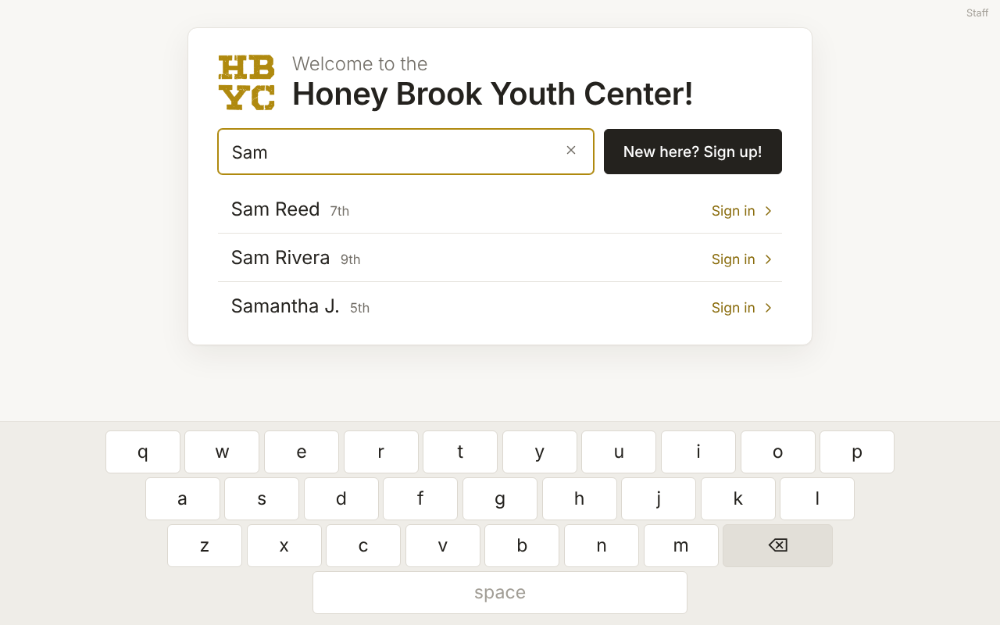
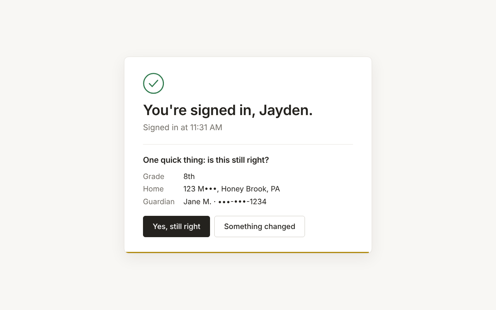
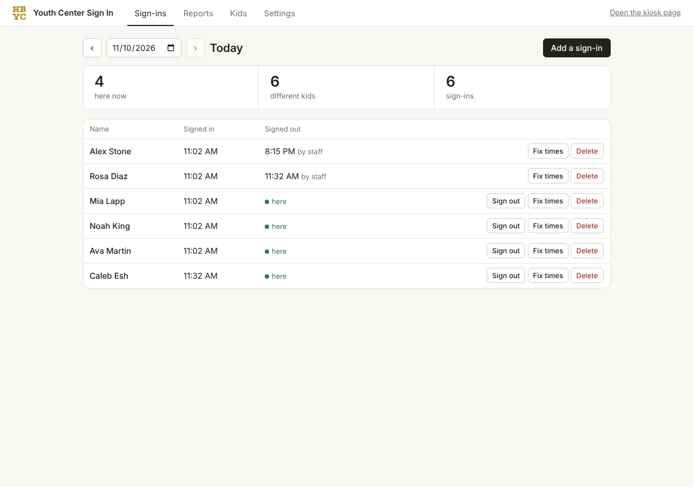

# Youth Center Sign In

A sign-in kiosk for the Honey Brook Youth Center. Kids type their name on a tablet at the
entrance and tap it. Staff see who is here, fix mistakes and pull reports from the office
computer.



> **Status.** This is the rewrite (Rust + Svelte). It has not run at the center yet. The old
> UWP app (`YouthCenterSignIn/`, `HBCCSignIn/`, `SignIn.Uwp/`, `SignIn.Logic/`) is still in
> this repo and stays in use until the switch-over described at the end.
> See [What has and hasn't been tested](#what-has-and-hasnt-been-tested).

## Contents

- [Install](#install)
- [How it works](#how-it-works)
- [Using it](#using-it)
- [Bring over the old sign-in logs](#bring-over-the-old-sign-in-logs)
- [Looking after it](#looking-after-it)
- [Get the Microsoft app ID](#get-the-microsoft-app-id) (once, by whoever maintains this)
- [Working on the code](#working-on-the-code)
- [What has and hasn't been tested](#what-has-and-hasnt-been-tested)
- [Switching over from the old app](#switching-over-from-the-old-app)

---

## Install

### On the office computer

Sign in to Windows as the person who normally uses the office computer, with OneDrive
signed in.

1. Download **YouthCenterSignIn.zip** from the latest [release](../../releases).
2. Right-click the zip, choose **Extract All**, and open the extracted folder.
3. Double-click **Install** (not "install-script"). If Windows says "Windows protected
   your PC", choose **More info**, then **Run anyway**.
4. When Windows asks "Do you want to allow this app to make changes?", choose **Yes**.

The installer copies the program to `C:\YouthCenterSignIn`, makes it start whenever you
sign in to Windows, lets the tablet through the firewall, and stops the computer from
sleeping. When it finishes it opens the **staff page** in your browser and shows the
**address for the tablet**. Write that address down. A "Sign In - Staff page" shortcut is
also put on the desktop.

Then, on the staff page under **Settings**:

5. **Admin PIN:** choose a PIN. This computer never needs it. Every other device does.
6. **Outlook contacts:** choose **Connect Outlook**. A short code and a Microsoft web
   address appear. Open that address on any phone or computer, type the code, and sign
   in with **the youth center's Microsoft account**. The page changes to "connected" by
   itself and the kids appear under **Kids**.
7. **Backups:** check that the folder shown is inside OneDrive.

### On the tablet

8. In Edge, open the address the installer showed, like `http://OFFICE-PC:8080`, and
   check the sign-in screen appears. The tablet must be on the same Wi-Fi as the office
   computer.
9. Windows Settings → Accounts → Other users → **Set up a kiosk** → Microsoft Edge →
   **As a digital sign or interactive display** → enter that address.

That's it. To bring over the old app's sign-in history, see
[Bring over the old sign-in logs](#bring-over-the-old-sign-in-logs).

### If something doesn't work

- **The tablet can't open the address.** Use the second address the installer showed
  (numbers, like `http://192.168.1.20:8080`). If that works, ask whoever looks after the
  router to give the office computer a fixed address, so it never changes. If neither
  works, run **Install** again and answer **Y** when it asks about marking the network
  as Private.
- **Settings says Outlook is "not set up".** This copy of the program has no Microsoft
  app ID yet. See [Get the Microsoft app ID](#get-the-microsoft-app-id).
- **Outlook asks to connect again later.** Microsoft forgets the sign-in after about 90
  days without use, for example over a long break. Choose Connect Outlook again.
- **Windows shows its own keyboard over the kiosk's.** Switch under Settings → Kiosk →
  Keyboard on the kiosk.
- **Changing the name, colors, logo or rules** (for example for the church): edit
  `C:\YouthCenterSignIn\config.toml` in Notepad. Each setting is explained in the file.

---

## How it works

```
 ┌──────────────── Office PC (on during open nights) ───────────────────────┐
 │                                                                           │
 │   signin.exe  ── one program, starts with Windows                         │
 │     ├─ serves the kiosk page and the staff page                           │
 │     ├─ stores sign-ins + a copy of the kids list in  data\signin.db       │
 │     ├─ syncs kids  ⇄  Outlook contacts                                    │
 │     └─ nightly backup  →  OneDrive\Youth Center Sign In\Backups\          │
 │                                                                           │
 │   Staff: open  http://localhost:8080/admin  in any browser                │
 └───────────────────────────────▲───────────────────────────────────────────┘
                                 │  same Wi-Fi
 ┌───────────────────────────────┴──────────────┐
 │  Tablet at the entrance                       │
 │  Edge in kiosk mode → http://OFFICE-PC:8080   │
 └───────────────────────────────────────────────┘
```

- **One place writes sign-ins.** Only `signin.exe` saves them, one at a time, into one
  database file. The old app had the tablet and the office PC each rewriting the same
  day's file through OneDrive, and whichever wrote last erased the other's entries.
- **No hosting and no bills.** Nothing runs on the internet except the Outlook contacts
  sync the center already uses.
- **Outlook stays the kids list** staff see on their phones. The program keeps its own
  copy, so searching is instant and sign-in keeps working when the internet is down.
- **The tablet doesn't wait on the network.** Each sign-in is saved on the tablet first,
  then sent. If the office PC can't be reached, sign-ins wait on the tablet and are sent
  when it is back, with the time the kid actually tapped.
- **Easy to hand over.** One folder (`C:\YouthCenterSignIn`) holds the program, its
  settings and its data.

---

## Using it

### Kids

| | |
|---|---|
|  |  |

- **Sign in:** type a few letters, tap your name. A confirmation shows for five seconds
  with an **Undo** button. Search forgives one typo.
- **Info check:** when a kid's address and guardian info is more than six months old, the
  confirmation also asks "is this still right?". The kid is already signed in by then, so
  walking away loses nothing. Saved info is shown mostly hidden (`123 M•••`, `•••-•••-1234`)
  because anyone can tap any name. "Something changed" lets them retype only the part
  that changed.
- **Sign out:** type your name and tap it, the same as signing in. The kiosk asks first,
  so nobody signs out by accident.
- **Sign up:** three short screens (about you, home and guardian, rules and the
  guardian's signature). Finishing signs the kid in too.
- Everyone still signed in at the nightly sign-out time (11 PM unless changed in Settings)
  is signed out automatically.

### Staff



Open <http://localhost:8080/admin> on the office PC, or tap the small "Staff" link on the
kiosk and enter the PIN.

- **Sign-ins:** today's list updates by itself. Pick any earlier day. Sign someone out,
  fix times, delete a wrong entry, or add one that was missed.
- **Reports:** sign-ins and different kids per month and per day for any range of dates,
  with a CSV download for Excel.
- **Kids:** search, add and edit. **Merge a duplicate** moves one kid's sign-ins to
  another and deletes the extra. **Remove** hides a kid from the kiosk and deletes their
  Outlook contact, and keeps their past sign-ins in the reports.
- **Settings:** Outlook connection and "Sync now", whether the kiosk is connected, the
  nightly sign-out time, backups, and the PIN.

Changes made in Outlook reach the kiosk within five minutes. Changes made at the kiosk or
on the staff page reach Outlook within seconds when the internet is up, and wait if it
is not.

---

## Bring over the old sign-in logs

The old app wrote one file per day (`2021-05-14.json`) into its OneDrive folder. One
command copies them all into the new database:

```
cd C:\YouthCenterSignIn
signin.exe import "%OneDrive%\Youth Center Sign In" --dry-run
signin.exe import "%OneDrive%\Youth Center Sign In"
```

Type these in a Command Prompt window (press Win+R, type `cmd`). It is fine to run them
while the program is running.

- `--dry-run` only reports: visits per day, files it could not read, and what would be
  added. Check the totals against the old app before running it for real.
- **Side copies are merged in.** When the tablet and the office PC both wrote the same
  day, OneDrive kept the loser under a longer name such as `2021-05-14-TABLET.json`. The
  import reads those too, so sign-ins that went missing can come back. The report shows
  how many were recovered per day.
- **Running it again is safe.** Each visit keeps the id the old app gave it, so nothing is
  added twice. Import early to try things out, then once more right before switching over.
- Kids are matched by their Outlook contact id, so it works before or after Outlook is
  connected. A kid whose contact has been deleted stays in the reports, hidden from the kiosk.
- Old visits with no sign-out are marked "never signed out". No time is made up.
- Old waiver signatures (the `COVID-19` folder) stay where they are. The Kids page finds
  them by name.
- The old admin PIN is not carried over. Set a new one.

---

## Looking after it

| What | Where |
|---|---|
| Database (sign-ins, kids, settings) | `C:\YouthCenterSignIn\data\signin.db` |
| Nightly database copies (last 60) | `<OneDrive folder>\Backups\signin-YYYY-MM-DD.db` |
| Daily logs for Excel | `<OneDrive folder>\Logs\YYYY-MM-DD.csv` |
| Guardian signatures | `<OneDrive folder>\Waivers\<Name>.png` |
| Program log (errors, sync activity) | `C:\YouthCenterSignIn\data\logs\signin.log.YYYY-MM-DD` |

The OneDrive folder is `Youth Center Sign In` in this computer's OneDrive, the same
folder the old app used. The live database is deliberately **not** in OneDrive, because syncing a database file
while it is in use can damage it. Only finished copies go there.

- **Update:** download the new zip and double-click **Install** again. Settings and data
  are kept, and the kiosk page reloads itself.
- **Restore a backup:** close the program's window, copy a backup file over
  `C:\YouthCenterSignIn\data\signin.db`, and start the program again from the Start
  menu's Startup folder or by restarting the computer.
- **Move to a new PC:** run **Install** on the new PC, close the program, copy the `data`
  folder and `config.toml` from the old PC over the new ones, and restart. Connect Outlook
  again, and give the tablet the new address.
- **Remove it:** delete the "Youth Center Sign In" shortcut from the Startup folder
  (press Win+R, type `shell:startup`), then delete `C:\YouthCenterSignIn`.
- **Forgot the PIN:** set a new one on the office PC under Settings. It doesn't ask for the old one.
- **Kiosk says it can't reach the office computer:** check the PC is on and awake, and
  that both are on the same Wi-Fi. Sign-ins made meanwhile are kept on the tablet until it
  reconnects. If the tablet itself was restarted while the PC was off, turn the PC on,
  then restart the tablet.
- **Handing off to someone else:** they need this README, the admin PIN, the youth
  center's Microsoft account, and access to this GitHub repo.

---

## Get the Microsoft app ID

Before the program may read and write Outlook contacts, Microsoft wants it registered as
an "app". This is free and done **once**, by whoever maintains this. The ID it gives is
not a secret. It is built into the program, so staff never see this step.

1. Go to <https://entra.microsoft.com> and sign in. Any Microsoft account that can open
   the Azure portal works. It does not have to be the youth center's account. If Microsoft
   asks you to sign up for Azure first, the free sign-up is enough and nothing here costs money.
2. Open **Applications → App registrations → New registration**.
   - Name: `Youth Center Sign In`
   - Supported account types: **Personal Microsoft accounts only**
   - Redirect URI: leave empty
   - Choose **Register**.
3. Open **Authentication**. Under "Advanced settings", set **Allow public client flows**
   to **Yes**, and save.
4. Open **API permissions → Add a permission → Microsoft Graph → Delegated permissions**,
   tick **Contacts.ReadWrite**, and choose **Add permissions**. `User.Read` is already there.
5. Open **Overview** and copy the **Application (client) ID**. It looks like
   `1a2b3c4d-0000-1111-2222-333344445555`.
6. Paste it into `server/src/config.rs`:

   ```rust
   pub const BUILT_IN_CLIENT_ID: &str = "paste-it-here";
   ```

   Commit, and push a new version tag to publish a release with the ID inside.

To try an ID without rebuilding, or to use a different registration on one computer, put
it in `C:\YouthCenterSignIn\config.toml`, which wins over the built-in one:

```toml
[microsoft]
client_id = "paste-it-here"
```

Microsoft renames these screens from time to time, so the labels may differ a little. If
the youth center's account is a work or school account instead of a personal one, choose
"Accounts in any organizational directory and personal Microsoft accounts" in step 2 and
set `tenant = "common"` in `config.toml`.

---

## Working on the code

```
server/                 Rust: the program that runs on the office PC
  src/main.rs           starts everything; also the `import` command
  src/config.rs         reads config.toml
  src/db.rs             the SQLite database; all SQL is in this file
  src/app.rs            shared state and the error type
  src/routes/kiosk.rs   what the tablet calls
  src/routes/admin.rs   what the staff page calls, and the PIN check
  src/routes/mod.rs     the route table and the web pages
  src/graph.rs          Outlook contacts sync
  src/notes.rs          the old "notes" format for grade and guardian
  src/backup.rs         nightly sign-out, backups and CSV logs
  src/import.rs         import of the old app's logs
  src/waivers.rs        guardian signature files
  src/tests.rs          end-to-end tests, with a stand-in for Microsoft
web/                    Svelte: the pages
  src/kiosk/            the tablet page
  src/admin/            the staff page
  src/lib/              shared: server calls, search, the offline queue
install/                what staff download, next to signin.exe
  Install.cmd           double-click to install or update
  install-script.ps1           the installer itself
  config.toml           the settings file, with every setting explained
```

You need [Rust](https://rustup.rs) and [Node.js](https://nodejs.org) 22 or newer.

```
cd web
npm install
npm run build        # builds the pages into web/dist

cd ../server
cargo run            # http://localhost:8080 and http://localhost:8080/admin
cargo test
```

`cargo build --release` bakes `web/dist` into the exe, so build the web pages first.
While working on the pages, run `cargo run` in one terminal and `npm run dev` in `web/`
in another. Open the address Vite prints, and the pages reload as you save. `npm run check`
type-checks the pages and `npm test` runs their tests.

GitHub Actions (`.github/workflows/signin.yml`) runs all tests on every push, builds
`signin.exe` on Windows, and runs the installer there to check the program starts.
Pushing a tag such as `v2.0.1` publishes `YouthCenterSignIn.zip` as a release.

**Notes for whoever maintains this:**

- The Rust is kept plain on purpose: handlers read a request, run SQL, and return JSON.
  Crates used: `axum` + `tokio` (web server), `rusqlite` (SQLite, compiled in), `reqwest`
  (calls to Microsoft), `rust-embed` (pages inside the exe), `serde`, `chrono`, `uuid`,
  `toml`, `tracing`, `anyhow`.
- The pages stay current by asking the server again every 10 to 20 seconds. There is no
  push channel from server to page.
- Things only needed while the program runs (logged-in sessions, the Outlook token) are
  in one `Memory` struct in `app.rs`. Everything that must survive a restart is in SQLite.
- Times are stored as local time text (`2026-11-10T18:42:05`).
- To change the database layout, add a new entry to `MIGRATIONS` in `db.rs`. Never edit
  an old one.
- The tablet makes the ids for visits and new kids. That is what makes a resent request
  harmless: the same id is only saved once.
- Outlook sync reads the whole contact list each time and compares. It is simple, and
  fine for a few hundred contacts.
- The kiosk page is served over plain `http` on the local network. Browsers turn some
  features off there (`crypto.randomUUID`, service workers), which is why `web/src/lib/uuid.ts`
  exists.

---

## What has and hasn't been tested

**Tested**, by 41 server tests, 11 page tests, and by driving both pages in a real
browser (Chromium):

- Sign in, sign out, undo, sign up with signature, the info check, auto sign-out.
- The kiosk with the server stopped: sign-ins waited on the tablet and arrived with the
  right time once the server was back.
- Staff page: fixing and adding visits, reports and CSV, editing, merging and removing
  kids, and the PIN being required from another address.
- Import of old-format logs, including side copies, a broken file, and running twice.
- Backups and daily CSV files.
- Outlook sync logic, against a **stand-in** Microsoft server written for the tests.
- **The installer and `signin.exe` on Windows.** Every push, GitHub builds the program on
  a Windows machine, runs the installer twice (install, then update), and checks the
  program answers, the database exists, and the startup shortcut and firewall rule are there.

**Not tested yet. Check these first at the center:**

1. **Outlook with the real account.** The sync has never talked to Microsoft itself, and
   the program has no Microsoft app ID until someone does
   [Get the Microsoft app ID](#get-the-microsoft-app-id). After "Connect Outlook",
   confirm the kids appear with grade and guardian filled in. Look at one contact in
   Outlook after a kiosk edit to confirm the notes still look right.
2. **The installer on the real office PC.** GitHub's Windows machine has no OneDrive, no
   "allow this app to make changes?" prompt and no download warning, so those three
   parts have not been seen working. After installing, check Settings → Backups shows
   a OneDrive folder.
3. **The real tablet in Edge kiosk mode:** speed, whether the Windows touch keyboard
   stays hidden, and how the screens fit its resolution (they were drawn at 1280×800 and
   scale with the screen).
4. **The import on a copy of the real OneDrive folder.** The old file format was worked
   out from the old app's code, not from real files.

---

## Switching over from the old app

1. [Install](#install) on the office PC and connect Outlook. Run the import with
   `--dry-run`, check the totals, then run it for real.
2. Try the kiosk page on the tablet in a normal Edge window while the old app is still
   the real kiosk.
3. On a quiet open night, run both: old app on the tablet as usual, new kiosk page open
   on a second device. Compare the counts at the end of the night.
4. Run the import one more time to pick up the last nights. Put the tablet into Edge
   kiosk mode pointing at the new page.
5. After a few good weeks, remove the old app from the tablet and the office PC, and
   move the old code in this repo into a `legacy/` folder (or delete it).
