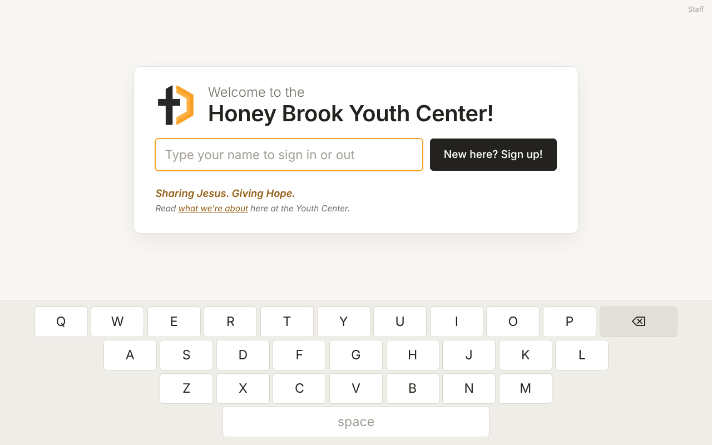
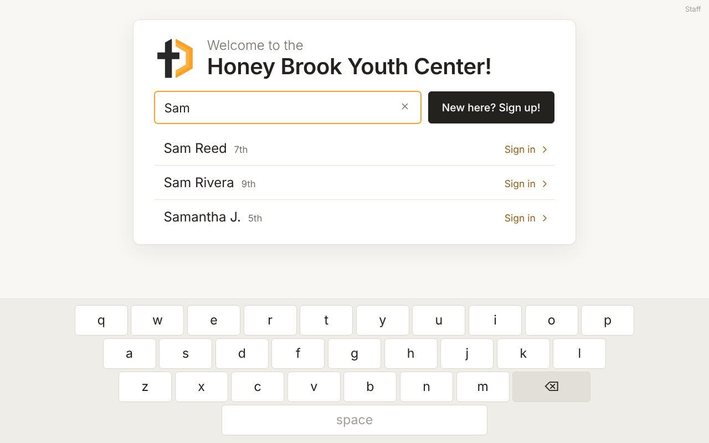
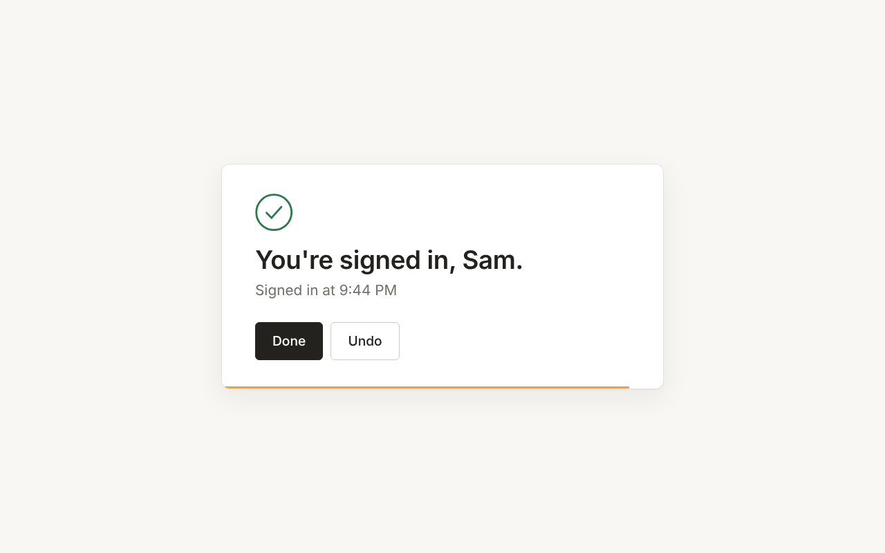
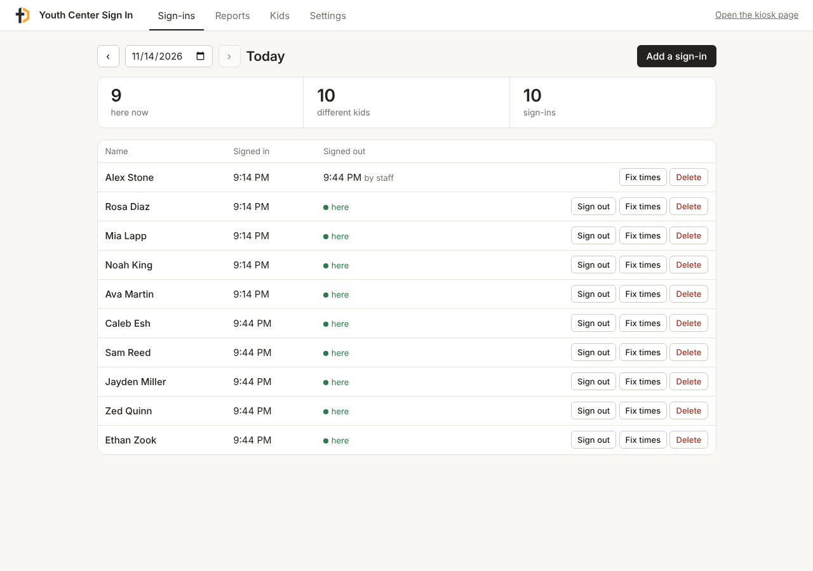

# Youth Center Sign In

The sign-in kiosk for the Honey Brook Youth Center. Kids type their name on a tablet at
the entrance and tap it. Staff see who is here, fix mistakes and get reports from the
office computer.



## Install

### On the office computer

Sign in to Windows as the person who normally uses the office computer, with OneDrive
signed in.

1. Download **YouthCenterSignIn.zip** from the latest [release](../../releases).
2. Right-click the zip, choose **Extract All**, and open the extracted folder.
3. Double-click **Install** (not "install-script"). If Windows says "Windows protected
   your PC", choose **More info**, then **Run anyway**.
4. When Windows asks "Do you want to allow this app to make changes?", choose **Yes**.

The installer puts the program in `C:\YouthCenterSignIn` and sets it to start when you
sign in to Windows. It also lets the tablet through the firewall and stops the computer
from sleeping. The program runs in a small window on the taskbar called "Youth Center
Sign In - please leave open".

When it finishes, it opens the **staff page** and shows the **address for the tablet**.
Write that address down. There is also a "Sign In - Staff page" shortcut on the desktop.

Then, on the staff page under **Settings**:

5. **Admin PIN:** choose a PIN. The office computer never asks for it. Other devices do.
6. **Outlook contacts:** choose **Connect Outlook**. Open the Microsoft address it shows
   on any phone or computer, type the code, and sign in with **the youth center's
   Microsoft account**. The kids appear under **Kids**.
7. **Backups:** check that the folder shown is inside OneDrive.

### On the tablet

8. In Edge, open the address the installer showed (like `http://OFFICE-PC:8080`) and
   check the sign-in screen appears. The tablet must be on the same Wi-Fi.
9. Windows Settings → Accounts → Other users → **Set up a kiosk** → Microsoft Edge →
   **As a digital sign or interactive display** → enter that address.

### If something doesn't work

- **The tablet can't open the address.** Try the second address the installer showed
  (numbers, like `http://192.168.1.20:8080`). If that works, ask whoever looks after the
  router to give the office computer a fixed address. If neither works, run **Install**
  again and answer **Y** when it asks about marking the network as Private.
- **Settings says Outlook is "not set up".** Download the latest version, or see
  [Get the Microsoft app ID](#get-the-microsoft-app-id).
- **Outlook asks to connect again.** Microsoft forgets the sign-in after about 90 days
  without use. Choose Connect Outlook again.
- **Windows shows its own keyboard over the kiosk's.** Turn it off under Settings →
  Kiosk → Keyboard on the kiosk.

---

## How it works

```
 Office computer                                 Tablet at the entrance
 ┌──────────────────────────────────────┐        ┌─────────────────────────┐
 │ signin.exe                           │ Wi-Fi  │ Edge in kiosk mode      │
 │  - serves the kiosk and staff pages  │◄──────►│ http://OFFICE-PC:8080   │
 │  - saves sign-ins in data\signin.db  │        └─────────────────────────┘
 │  - syncs kids with Outlook contacts  │
 │  - backs up to OneDrive each night   │
 └──────────────────────────────────────┘
```

- **Only the office computer saves sign-ins**, into one database. (The old app had two
  computers writing the same file through OneDrive, and sign-ins went missing.)
- **The tablet never waits on the network.** It saves each sign-in first, then sends it.
  If the office computer is off, sign-ins wait on the tablet and arrive later with the
  right time.
- **Outlook is still the kids list.** The program keeps a copy, so search is instant and
  works without internet.
- **Nothing is hosted online and nothing costs money.** Only the Outlook sync uses the
  internet.

---

## Using it

### Kids

| | |
|---|---|
|  |  |

- **Sign in or out:** type a few letters and tap your name. Search forgives one typo.
  Signing in shows **Undo** for a few seconds. Signing out asks first.
- **Sign up:** three short screens: about you, home and guardian, then the rules and the
  guardian's signature. Finishing also signs the kid in. Tapping a nearby town fills in
  the town and state (the towns are in `web/src/lib/center.ts`).
- **Siblings:** after a sign-up, **Sign up a sibling** starts the next kid with the same
  last name, home and guardian. The guardian signs again for each kid.
- **18 and older** give their own phone number and sign for themselves.
- **Once a school year**, at a kid's first sign-in on or after August 1, the kiosk asks
  their grade and has them check their home and guardian. They are already signed in, so
  walking away loses nothing. Saved info is partly hidden (`123 M•••`) because anyone can
  tap any name.
- Anyone still signed in at 11 PM is signed out automatically (change the time in
  Settings).

### Staff



Open <http://localhost:8080/admin> on the office computer, or tap "Staff" on the kiosk
and enter the PIN. Going back to the kiosk locks the staff page again.

- **Sign-ins:** today's list, or any earlier day. Sign someone out, fix times, delete a
  wrong entry or add a missed one. Tap a name to see that kid.
- **Reports:** sign-ins and different kids per month and per day, with a CSV download
  for Excel.
- **Kids:** search, add and edit. **Merge a duplicate** moves one kid's sign-ins to
  another. **Remove** hides a kid from the kiosk and Outlook but keeps their sign-ins in
  the reports.
- **Settings:** Outlook, the kiosk connection, the nightly sign-out time, backups and
  the PIN.
- **Install as an app** (top right) gives the staff page its own window.

Changes in Outlook reach the kiosk within five minutes. Changes on the kiosk or staff
page reach Outlook within seconds when the internet is up.

---

## Bring over the old sign-in logs

The old app saved one file per day in OneDrive. To copy them into the new database,
press Win+R, type `cmd`, and run:

```
cd C:\YouthCenterSignIn
signin.exe import "%OneDrive%\Youth Center Sign In" --dry-run
signin.exe import "%OneDrive%\Youth Center Sign In"
```

- `--dry-run` only reports what it would add. Check the totals before running it for real.
- Running it again is safe. Nothing is added twice.
- Connect Outlook first, so old sign-ins are matched to the right kids. Kids it can't
  match are listed. Kids from years ago are expected there.
- It also reads the extra copies OneDrive made when two computers saved the same day, so
  some lost sign-ins come back.
- Old signatures stay in the old `COVID-19` folder. The Kids page finds them by name.

---

## Looking after it

| What | Where |
|---|---|
| Database | `C:\YouthCenterSignIn\data\signin.db` |
| Nightly backups (last 60) | `OneDrive\Youth Center Sign In\Backups` |
| Daily logs for Excel | `OneDrive\Youth Center Sign In\Logs` |
| Guardian signatures | `OneDrive\Youth Center Sign In\Waivers` |
| Program log (errors) | `C:\YouthCenterSignIn\data\logs` |

The live database is **not** in OneDrive on purpose: syncing a database while it is in
use can damage it. Only the backups go there.

### Keeping it running

The program runs while its window is open. It starts when someone signs in to Windows.
So after a restart, it isn't running until someone signs in. Meanwhile the tablet says it
can't reach the office computer, and keeps sign-ins until it can.

- To have the computer sign itself in after a restart, use Microsoft's free
  **Sysinternals Autologon**, or press Win+R, type `netplwiz`, and untick "Users must
  enter a user name and password". On Windows 11 that box only shows after turning off
  **Settings → Accounts → Sign-in options → "only allow Windows Hello sign-in"**.
- Set **Settings → Windows Update → Active hours** to cover open nights.
- If the tablet was restarted while the office computer was off, turn the computer on,
  then restart the tablet.

### Other jobs

- **Update:** download the new zip and double-click **Install**. Settings and data are
  kept.
- **Restore a backup:** close the program's window, copy the backup over
  `C:\YouthCenterSignIn\data\signin.db`, and restart the computer.
- **Move to a new computer:** run **Install** on it, close the program, copy over the
  `data` folder and `config.toml` from the old one, and restart. Connect Outlook again
  and give the tablet the new address.
- **Remove it:** press Win+R, type `shell:startup`, delete the "Youth Center Sign In"
  shortcut, then delete `C:\YouthCenterSignIn`.
- **Forgot the PIN:** set a new one on the office computer under Settings.
- **Handing it to someone else:** they need this README, the PIN, the youth center's
  Microsoft account, and access to this GitHub repo.

---

## Get the Microsoft app ID

Microsoft needs the program registered as an "app" before it can use Outlook contacts.
This is free, done **once** by whoever maintains this, and already built into the
releases. The ID is not a secret. Don't create a password or "client secret".

1. Go to <https://entra.microsoft.com> and sign in with any Microsoft account. If asked
   to sign up for Azure, the free sign-up is enough.
2. **Applications → App registrations → New registration.** Name: `Youth Center Sign In`.
   Account types: **Personal Microsoft accounts only**. Leave Redirect URI empty.
   **Register**.
3. **Authentication:** set **Allow public client flows** to **Yes** and save.
4. **API permissions → Add a permission → Microsoft Graph → Delegated permissions:**
   tick **Contacts.ReadWrite** and **Add permissions**. A note about admin consent can
   be ignored.
5. **Overview:** copy the **Application (client) ID**.
6. Paste it into `server/src/config.rs` (`BUILT_IN_CLIENT_ID`), commit, and publish a new
   release.

To try an ID without a new release, put it in `C:\YouthCenterSignIn\config.toml`:

```toml
[microsoft]
client_id = "paste-it-here"
```

If the center's account is a work or school account, choose "Accounts in any
organizational directory and personal Microsoft accounts" in step 2, and add
`tenant = "common"` under `[microsoft]` in `config.toml`.

---

## Working on the code

```
server/          Rust: the program on the office computer (all SQL is in db.rs)
web/src/kiosk/   Svelte: the tablet page
web/src/admin/   Svelte: the staff page
web/src/lib/     shared code; center.ts has the center's name, rules and waiver text
install/         the installer and settings file staff download
```

You need [Rust](https://rustup.rs) and [Node.js](https://nodejs.org) 22 or newer.

```
cd web && npm install && npm run build    # build the pages first: they go inside the exe
cd server && cargo run                    # http://localhost:8080 and /admin
cd server && cargo test                   # server tests
cd web && npm run check && npm test       # page tests
```

While working on the pages, run `cargo run` and `npm run dev` (in `web/`) side by side,
and open the address Vite prints.

Every push runs the tests on GitHub, builds `signin.exe` on Windows and tries the
installer there. To publish a release, make one on GitHub's Releases page with a new tag
like `v2.0.1`. The build attaches `YouthCenterSignIn.zip` about ten minutes later.

[AGENTS.md](AGENTS.md) has the rules for changing the code.
